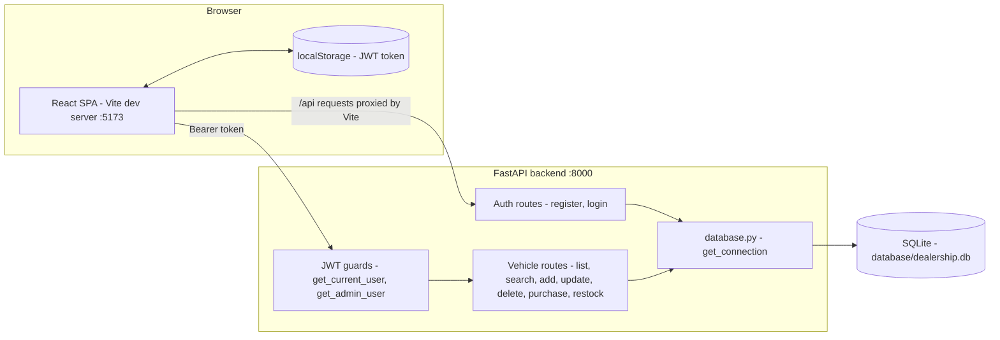
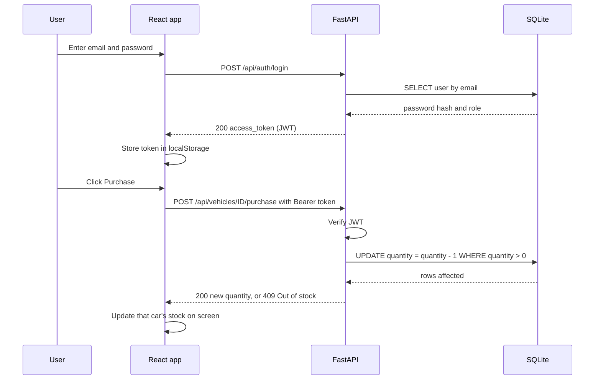
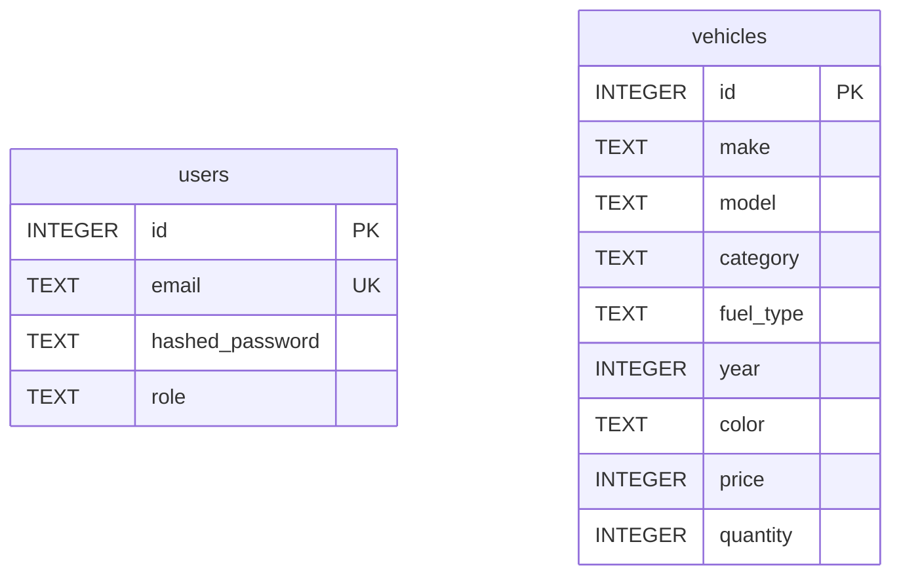

# Car Dealership

A full-stack web application for a car dealership. Customers register and log in, browse the vehicle inventory, search and filter it, and purchase cars. Administrators can additionally delete vehicles and restock inventory through the API.

- **Repository:** https://github.com/vrinda-code/incube_car
- **Stack:** React 19 · Vite · Tailwind CSS · FastAPI · SQLite · JWT authentication
- **Tests:** 37 automated pytest tests (authentication, validation, CRUD, search, purchase, restock, permissions)

---

## Table of Contents

1. [Project Overview](#project-overview)
2. [Screenshots](#screenshots)
3. [Features](#features)
4. [Tech Stack](#tech-stack)
5. [Architecture](#architecture)
6. [Project Structure](#project-structure)
7. [Setup and Run Locally](#setup-and-run-locally)
8. [API Reference](#api-reference)
9. [Database Schema](#database-schema)
10. [Authentication and Roles](#authentication-and-roles)
11. [Testing and Test Report](#testing-and-test-report)
12. [Development Approach](#development-approach)
13. [Known Limitations and Future Improvements](#known-limitations-and-future-improvements)
14. [My AI Usage](#my-ai-usage)
15. [Submission Checklist](#submission-checklist)

---

## Project Overview

The goal of this project is to build a small but realistic inventory-and-sales system for a car dealership, covering the full stack: a REST API with authentication and role-based access control, a relational database with enforced constraints, a responsive single-page frontend, and an automated test suite.

**What a user can do**

1. Create an account and log in (passwords are hashed; sessions use short-lived JWTs).
2. View the full vehicle inventory with photos, prices in Indian Rupees, category, fuel type and live stock levels.
3. Search by make or model, and filter by category and price range.
4. Purchase a vehicle. Stock decreases by one; when it reaches zero the car shows as out of stock and cannot be bought.

**What an administrator can do (via the API)**

- Delete vehicles and restock inventory. These endpoints return `403 Forbidden` for normal users.

## Screenshots

### Login page


### Dashboard: search form and vehicle inventory


### Search and filter in action
Filtering by make "Toyota", category "Sedan" and minimum price 0 returns a single matching car. The contact footer is visible below the results.


## Features

- **Registration and login** with salted password hashing and JWT access tokens (1-hour expiry)
- **Protected routes**: the dashboard requires a valid session; an expired token automatically logs the user out
- **Vehicle inventory** displayed as cards with photo, formatted price (₹, Indian digit grouping), category, fuel type and stock
- **Search and filter** by make, model (partial, case-insensitive), category and price range, in any combination
- **Purchase flow** with atomic stock decrement that can never go below zero; the UI disables the button for out-of-stock cars
- **Role-based access control** with `user` and `admin` roles
- **Complete vehicle API**: create, read, update, delete, search, purchase and restock
- **Graceful image fallback**: cars without a photo show a "No photo" placeholder
- **Test suite** of 37 isolated tests, each running against its own temporary database

## Tech Stack

| Layer | Technology |
|---|---|
| Frontend | React 19, React Router 7, Vite, Tailwind CSS 4 |
| Backend | Python, FastAPI, Pydantic, PyJWT |
| Database | SQLite (Python's built-in `sqlite3`) |
| Authentication | JWT (HS256) in the `Authorization: Bearer` header; PBKDF2-HMAC-SHA256 password hashing with a per-user random salt |
| Testing | pytest, FastAPI `TestClient` |

## Architecture

The application follows a three-tier design. The React single-page app talks to the FastAPI backend over a JSON REST API, and the backend reads and writes a SQLite database file.



### Request flow



1. **Register / login.** The frontend calls `/api/auth/register` or `/api/auth/login`. On login the backend verifies the password hash and returns a signed JWT containing `user_id`, `role` and an expiry.
2. **Token storage.** `AuthContext` saves the token in `localStorage` and reads the `role` claim from its payload to show the role badge.
3. **Authenticated calls.** Every helper in `src/api.js` attaches `Authorization: Bearer <token>`. The backend dependency `get_current_user` validates the token on each request; `get_admin_user` additionally requires `role == "admin"`.
4. **Expiry handling.** If the backend answers `401`, the dashboard logs the user out and redirects to `/login`.
5. **Dev proxy.** In development, Vite forwards any `/api` request to `http://127.0.0.1:8000`, so no CORS setup or hard-coded backend URL is needed.

### Key design decisions

- **Parameterised SQL only.** Search filters are built with `?` placeholders, never by formatting user input into the query, which prevents SQL injection.
- **Atomic stock updates.** Purchase runs `UPDATE ... SET quantity = quantity - 1 WHERE id = ? AND quantity > 0`, so two simultaneous buyers cannot oversell the last car. A zero-row result is then resolved into `404` (no such vehicle) or `409` (out of stock).
- **Two layers of validation.** Pydantic models validate API input (`Literal` types for category and fuel type, `price > 0`, `quantity >= 0`) and the database enforces the same rules with `CHECK` constraints.
- **Single source for the DB path.** `database.py` resolves the database file relative to itself; the test fixture swaps in a temporary file so tests never touch real data.

## Project Structure

```
incube_car/
├── PROMPTS.md                   # AI chat logs / links
├── README.md
├── docs/screenshots/            # Screenshots used in this README
├── backend/
│   ├── main.py                  # FastAPI app: auth, vehicles, purchase, restock
│   ├── database.py              # SQLite connection helper
│   ├── setup_db.py              # Creates tables and seeds 11 sample cars
│   ├── make_admin.py            # CLI helper to promote a user to admin
│   ├── requirements.txt         # Python dependencies
│   ├── conftest.py              # pytest fixture: fresh temp database per test
│   ├── test_auth.py             # Registration and login tests
│   └── test_vehicles.py         # Vehicle CRUD, search, purchase, restock tests
├── database/
│   └── dealership.db            # SQLite file (generated by setup_db.py)
└── frontend/
    ├── index.html
    ├── vite.config.js           # Tailwind plugin + /api proxy to the backend
    ├── public/cars/             # Vehicle photos, named <make>-<model>.jpg
    └── src/
        ├── main.jsx             # Entry point (Router + AuthProvider)
        ├── App.jsx              # Routes + ProtectedRoute
        ├── AuthContext.jsx      # Token and role state, login, logout
        ├── api.js               # Single fetch wrapper + API helpers
        ├── pages/               # Login, Register, Dashboard
        └── components/          # Navbar, VehicleCard, AuthForm
```

## Setup and Run Locally

### Prerequisites

- Python 3.10 or newer
- Node.js 18 or newer, with npm
- Git

### 1. Clone the repository

```bash
git clone https://github.com/vrinda-code/incube_car.git
cd incube_car
```

### 2. Backend (FastAPI)

```bash
cd backend

# Create and activate a virtual environment (recommended)
python -m venv venv
source venv/bin/activate          # Windows: venv\Scripts\activate

# Install dependencies
pip install -r requirements.txt

# Create the tables and seed the sample vehicles (safe to re-run)
python setup_db.py

# Start the API on http://127.0.0.1:8000
uvicorn main:app --reload
```

Interactive API documentation is generated automatically at **http://127.0.0.1:8000/docs**.

### 3. Frontend (React + Vite)

Open a **second terminal**:

```bash
cd frontend
npm install
npm run dev
```

Open the address Vite prints, normally **http://localhost:5173**. Keep the backend running, because the frontend proxies `/api` requests to it.

### 4. Use the application

1. Click **Register** and create an account (password: at least 8 characters).
2. Log in. The dashboard shows the seeded inventory.
3. Use the search form to filter cars and click **Purchase** to buy one.

### 5. Create an admin user (optional)

New accounts have the `user` role. Register the account in the UI first, then promote it:

```bash
cd backend
python make_admin.py
# Email of the user to make admin: you@example.com
```

Log out and log in again so a new token carrying the `admin` role is issued. Admin-only endpoints (delete, restock) can then be tried from the Swagger UI at `/docs`: click **Authorize** and paste the token.

### Production build of the frontend

```bash
cd frontend
npm run build       # static files in frontend/dist
npm run preview     # serve the built app locally
```

The built app calls relative `/api/...` URLs, so in production it must be served behind a reverse proxy that forwards `/api` to the FastAPI service.

## API Reference

Base URL: `http://127.0.0.1:8000`. Every `/api/vehicles` route requires the header `Authorization: Bearer <token>`.

| Method | Endpoint | Access | Description | Success | Errors |
|---|---|---|---|---|---|
| POST | `/api/auth/register` | Public | Create an account (`email`, `password` of 8+ chars) | 201 | 409 email taken, 422 invalid input |
| POST | `/api/auth/login` | Public | Returns `{"access_token": "..."}` | 200 | 401 bad credentials |
| GET | `/api/vehicles` | Logged in | List all vehicles | 200 | 401 |
| GET | `/api/vehicles/search` | Logged in | Filter by `make`, `model`, `category`, `min_price`, `max_price` | 200 | 401, 422 if min > max |
| POST | `/api/vehicles` | Logged in | Add a vehicle | 201 | 401, 422 |
| PUT | `/api/vehicles/{id}` | Logged in | Update a vehicle | 200 | 401, 404, 422 |
| DELETE | `/api/vehicles/{id}` | Admin | Delete a vehicle | 200 | 401, 403, 404 |
| POST | `/api/vehicles/{id}/purchase` | Logged in | Decrease stock by 1 | 200 | 401, 404, 409 out of stock |
| POST | `/api/vehicles/{id}/restock` | Admin | Increase stock by `amount` (> 0) | 200 | 401, 403, 404, 422 |

**Example requests**

```bash
# Log in
curl -X POST http://127.0.0.1:8000/api/auth/login \
  -H "Content-Type: application/json" \
  -d '{"email":"you@example.com","password":"yourpassword"}'

# Search for SUVs up to 20 lakh rupees
curl "http://127.0.0.1:8000/api/vehicles/search?category=suv&max_price=2000000" \
  -H "Authorization: Bearer <token>"
```

**Vehicle object**

```json
{
  "id": 1,
  "make": "Toyota",
  "model": "Camry",
  "category": "sedan",
  "fuel_type": "petrol",
  "year": 2024,
  "color": "White",
  "price": 2800000,
  "quantity": 5
}
```

`category` is one of `sedan`, `hatchback`, `suv`, `sports`. `fuel_type` is one of `petrol`, `diesel`, `electric`.

## Database Schema



- `users.hashed_password` stores `salt:hash`; `users.role` defaults to `user`.
- `vehicles.category` and `vehicles.fuel_type` are restricted by `CHECK` constraints, `price` must be greater than 0 and `quantity` must be 0 or more.
- `setup_db.py` seeds 11 vehicles (Toyota Camry, Honda City, Hyundai i20, Maruti Suzuki Swift, Hyundai Creta, Tata Nexon EV, Mahindra XUV700, Porsche 911, Tata Tiago EV, BMW 3 Series, Ferrari 296 GTB) and inserts them only if the table is empty.

## Authentication and Roles

- **Passwords** are hashed with PBKDF2-HMAC-SHA256 (100,000 iterations) and a fresh 16-byte random salt per user, stored as `salt:hash`. Plaintext passwords are never stored; a test verifies this.
- **Tokens** are HS256 JWTs carrying `user_id`, `role` and `exp` (1 hour).
- **Roles.** `get_current_user` accepts any valid token. `get_admin_user` builds on it and returns `403` unless `role == "admin"`.

## Testing and Test Report

The backend has **37 tests**. `conftest.py` gives every test a fresh temporary SQLite database, so tests are isolated, order-independent and never modify `dealership.db`.

```bash
cd backend
pip install -r requirements.txt
pytest -v
```

### Test inventory

| Area | File | Tests | What is verified |
|---|---|---|---|
| Registration | `test_auth.py` | 4 | User is created; duplicate email rejected; short password rejected; password is not stored as plaintext |
| Login | `test_auth.py` | 3 | Valid login returns a token; wrong password rejected; unknown email rejected |
| Authentication guard | `test_vehicles.py` | 3 | List without token rejected; fake token rejected; valid token accepted |
| Add vehicle | `test_vehicles.py` | 4 | Vehicle is added; missing token rejected; invalid category rejected; negative price rejected |
| Search | `test_vehicles.py` | 7 | Case-insensitive make search; category filter; price range; combined filters; no match returns empty list; missing token rejected; min price above max price rejected |
| Update | `test_vehicles.py` | 4 | Vehicle is updated; unknown ID returns 404; missing token rejected; invalid data rejected |
| Delete (admin only) | `test_vehicles.py` | 4 | Admin can delete; normal user gets 403; missing token rejected; unknown ID returns 404 |
| Purchase | `test_vehicles.py` | 4 | Stock decreases; out-of-stock purchase rejected; missing token rejected; unknown ID returns 404 |
| Restock (admin only) | `test_vehicles.py` | 4 | Admin can restock; normal user gets 403; invalid amount rejected; unknown ID returns 404 |
| **Total** | | **37** | |

### Test results

Output of `pytest -v` run from the `backend/` directory:

```text
PASTE THE FULL OUTPUT OF `pytest -v` HERE
```

## Development Approach

The git history shows the backend was built **test-first**: each feature starts with a `test:` commit that defines the expected behaviour, followed by a `feat:` commit that implements it. The order was registration, login with JWT, protected vehicle list, add vehicle, search with filters, update, admin-only delete, then purchase and restock. The React frontend followed (base UI, then search filters).

## Known Limitations and Future Improvements

- **Secret key is hard-coded** in `main.py` (`SECRET_KEY = "change-this-secret"`); it should be read from an environment variable in any real deployment.
- **Create and update are open to any logged-in user.** Only delete and restock are admin-only; restricting create and update is a one-line change (`Depends(get_admin_user)`).
- **No admin screens in the UI.** Add, edit, delete and restock are available through the API only.
- **Purchases are not recorded.** There is no orders table, so there is no purchase history or per-user ownership.
- **Password comparison** uses `==`; `hmac.compare_digest` would be a constant-time alternative.
- **Token in `localStorage`** is simple but exposed to XSS; httpOnly cookies are more robust.
- **Next steps:** pagination, image upload, order history, Docker Compose, CI running the pytest suite, database migrations (Alembic) and PostgreSQL for production.

---

## My AI Usage

Full chat history is in [PROMPTS.md](PROMPTS.md).

### AI tools used

| Tool | Role in the project |
|---|---|
| **ChatGPT** | Main assistant throughout the project: planning, explanations, test-case ideas, code help, debugging and documentation. The complete conversation is linked in `PROMPTS.md`. |
| **VS Code AI chat** | In-editor assistant used for small, local fixes: typos, syntax and import errors, minor bug corrections and Tailwind class adjustments, without leaving the code. |

### How I used them

- **Planning and design.** I used ChatGPT to think through the overall architecture (React frontend, FastAPI backend, SQLite), the REST endpoint structure, the `users` and `vehicles` tables and the role model, then made the final choices myself.
- **Test-driven development.** I worked test-first. I used ChatGPT to help identify edge cases for each endpoint, such as duplicate emails, fake or missing tokens, invalid categories, out-of-stock purchases and non-admin access to admin routes, and wrote each test before the implementation.
- **Learning the concepts behind the code.** I asked for explanations of password hashing with salts, how JWTs are issued and verified, FastAPI dependencies, and why stock must be decremented in a single conditional `UPDATE` to avoid overselling. I added explanatory comments in the code so I could revisit the reasoning.
- **Frontend.** I used ChatGPT for guidance on structuring the React app (context for authentication, a protected route, a single API helper) and on Tailwind layout for the vehicle cards and search form.
- **Small corrections.** The VS Code chat handled quick, narrowly scoped fixes during development rather than design or architecture work.
- **Documentation.** I used AI assistance to organise and polish this README and the architecture diagrams, then checked the content against the actual code.

### How I verified AI output and used it responsibly

- I treated AI output as a draft. I ran the full pytest suite after changes and checked the running app in the browser instead of trusting generated code.
- I only kept code I could explain line by line, and I can walk through any file in the repository.
- I reviewed the result for security: hashed and salted passwords, parameterised SQL, token expiry, and role checks on admin routes. The remaining gaps I found are listed openly under [Known Limitations](#known-limitations-and-future-improvements).
- I committed in small steps (`test:` then `feat:`), which kept every AI-assisted change reviewable and easy to revert.

### Reflection: how AI changed my workflow

- **What it sped up:** brainstorming edge cases, understanding unfamiliar concepts quickly, boilerplate, Tailwind styling and diagnosing error messages.
- **What it could not replace:** deciding what the system should do, reviewing code critically, security judgement, and debugging how the frontend and backend fit together.
- **What I learned:** AI is most useful when I ask for explanations and alternatives rather than finished answers, and when tests define correct behaviour first. A failing test gave me an objective way to judge whether a suggestion actually worked.
- **What I would do differently:** write more of each first draft myself before asking for review, and bring up security concerns (secret handling, authorisation on every write endpoint) earlier in the process.

### Interview readiness

I can discuss any part of this project in detail, including where AI helped and where I decided differently: the PBKDF2 hashing, the JWT dependency chain and role checks, the atomic purchase query, the test fixture that swaps the database path, and the React authentication flow.

## Submission Checklist

| Deliverable | Where |
|---|---|
| Public Git repository | https://github.com/vrinda-code/incube_car |
| Project explanation | [Project Overview](#project-overview) |
| Local setup (backend and frontend) | [Setup and Run Locally](#setup-and-run-locally) |
| Screenshots | [Screenshots](#screenshots) |
| "My AI Usage" section | [My AI Usage](#my-ai-usage) |
| Test report | [Testing and Test Report](#testing-and-test-report) |
| Raw AI chat logs / links | [PROMPTS.md](PROMPTS.md) |
