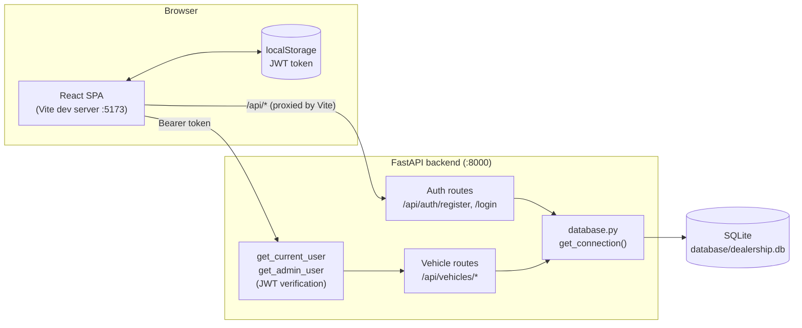
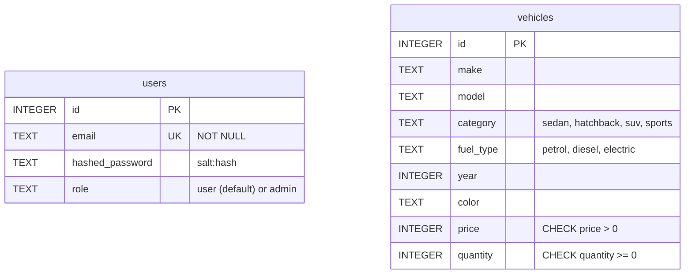

# 🚗 Car Dealership

A full-stack car dealership web app. Users register and log in, browse the vehicle inventory, search and filter it, and purchase cars. Admins can additionally delete vehicles and restock inventory through the API.

**Stack:** React 19 + Vite + Tailwind CSS (frontend) · FastAPI (backend) · SQLite (database) · JWT authentication

---

## Table of Contents

1. [Features](#features)
2. [Tech Stack](#tech-stack)
3. [Architecture](#architecture)
4. [Project Structure](#project-structure)
5. [Getting Started (How to Access)](#getting-started-how-to-access)
6. [API Reference](#api-reference)
7. [Database Schema](#database-schema)
8. [Authentication and Roles](#authentication-and-roles)
9. [Testing](#testing)
10. [Development Approach](#development-approach)
11. [Known Limitations and Future Improvements](#known-limitations-and-future-improvements)
12. [My AI Usage](#my-ai-usage)

---

## Features

- **User registration and login** with salted password hashing and JWT access tokens (1-hour expiry)
- **Protected routes**: the dashboard is only reachable when logged in; expired tokens send the user back to login
- **Vehicle inventory** shown as cards with photo, price (formatted in ₹, Indian numbering), category, fuel type and stock
- **Search and filter** by make, model, category and price range (combinable)
- **Purchase** a vehicle: stock is decremented atomically and can never go below zero; out-of-stock cars are disabled in the UI
- **Role-based access control**: `user` and `admin` roles; delete and restock are admin-only
- **Full CRUD API** for vehicles (create, read, update, delete) plus restock
- **Automated tests**: 37 pytest tests covering auth, validation, CRUD, search, purchase, restock and permissions

## Tech Stack

| Layer | Technology |
|---|---|
| Frontend | React 19, React Router 7, Vite 8, Tailwind CSS 4 |
| Backend | Python, FastAPI, Pydantic, PyJWT |
| Database | SQLite (via Python's built-in `sqlite3`) |
| Auth | JWT (HS256) in the `Authorization: Bearer` header; PBKDF2-HMAC-SHA256 password hashing with a per-user random salt |
| Testing | pytest, FastAPI `TestClient` |

## Architecture

The app is a classic three-tier design. The React single-page app talks to the FastAPI backend over a JSON REST API, and the backend reads and writes a SQLite database file.



### Request flow

1. **Register / Login**: the frontend calls `/api/auth/register` or `/api/auth/login`. On login, the backend verifies the password hash and returns a signed JWT containing `user_id`, `role` and an expiry.
2. **Token storage**: `AuthContext` saves the token in `localStorage` and decodes the `role` claim from its payload to drive UI such as the role badge.
3. **Authenticated calls**: every API helper in `src/api.js` attaches `Authorization: Bearer <token>`. The backend's `get_current_user` dependency validates the token on each request; `get_admin_user` additionally requires `role == "admin"`.
4. **Expiry handling**: if the backend returns `401`, the dashboard logs the user out and redirects to `/login`.
5. **Dev proxy**: in development, Vite proxies any `/api` request to `http://127.0.0.1:8000`, so the frontend needs no CORS configuration or hard-coded backend URL.

### Key design decisions

- **Raw `sqlite3` with parameterised queries** keeps the data layer small and transparent, and prevents SQL injection (search filters are built with `?` placeholders, never string-formatted values).
- **Atomic stock updates**: purchase runs `UPDATE ... SET quantity = quantity - 1 WHERE id = ? AND quantity > 0`, so two simultaneous purchases can't oversell the last car. A zero-row result is then disambiguated into `404` (no such vehicle) or `409` (out of stock).
- **Validation in two layers**: Pydantic models validate API input (`Literal` types for category and fuel type, `price > 0`, `quantity >= 0`), and the database enforces the same rules with `CHECK` constraints.
- **Database path in one place**: `database.py` resolves the DB file relative to itself, and the test suite swaps `database.DB_PATH` for a temporary file so tests never touch real data.

## Project Structure

```
carsdealership/
├── backend/
│   ├── main.py              # FastAPI app: auth, vehicles, purchase, restock
│   ├── database.py          # SQLite connection helper
│   ├── setup_db.py          # Creates tables and seeds 11 sample cars
│   ├── make_admin.py        # CLI helper to promote a user to admin
│   ├── conftest.py          # pytest fixture: fresh temp database per test
│   ├── test_auth.py         # Registration and login tests
│   └── test_vehicles.py     # Vehicle CRUD, search, purchase, restock tests
├── database/
│   └── dealership.db        # SQLite file (generated by setup_db.py)
└── frontend/
    ├── index.html
    ├── vite.config.js       # Tailwind plugin + /api proxy to the backend
    ├── public/cars/         # Vehicle photos, named <make>-<model>.jpg
    └── src/
        ├── main.jsx         # App entry (Router + AuthProvider)
        ├── App.jsx          # Routes + ProtectedRoute
        ├── AuthContext.jsx  # Token/role state, login, logout
        ├── api.js           # Single fetch wrapper + API helpers
        ├── pages/           # Login, Register, Dashboard
        └── components/      # Navbar, VehicleCard, AuthForm
```

## Getting Started (How to Access)

### Prerequisites

- **Python 3.10+**
- **Node.js 18+** and npm

### 1. Clone the repository

```bash
git clone https://github.com/vrinda-code/incube_car.git
cd incube_car
```

### 2. Start the backend

```bash
cd backend

# (recommended) create a virtual environment
python -m venv venv
source venv/bin/activate        # Windows: venv\Scripts\activate

# install dependencies
pip install -r requirements.txt

# create the tables and seed the sample vehicles (safe to re-run)
python setup_db.py

# run the API on http://127.0.0.1:8000
uvicorn main:app --reload
```

Interactive API docs are generated automatically at **http://127.0.0.1:8000/docs**.

### 3. Start the frontend

Open a second terminal:

```bash
cd frontend
npm install
npm run dev
```

Open the URL Vite prints (normally **http://localhost:5173**).

### 4. Use the app

1. Click **Register** and create an account (password must be at least 8 characters).
2. Log in. You'll land on the dashboard with the seeded inventory.
3. Use the search form to filter cars, and click **Purchase** to buy one.

### 5. (Optional) Create an admin user

New accounts get the `user` role. To promote one, register it in the UI first, then run:

```bash
cd backend
python make_admin.py
# Email of the user to make admin: you@example.com
```

Log out and back in so a new token carrying the `admin` role is issued. Admin-only endpoints (delete, restock) can then be exercised from the Swagger UI at `/docs` (click **Authorize** and paste the token).

### Production build

```bash
cd frontend
npm run build      # outputs static files to frontend/dist
npm run preview    # serve the built app locally
```

> Note: the built frontend still calls relative `/api/...` URLs, so in production serve it behind a reverse proxy that forwards `/api` to the FastAPI app.

## API Reference

Base URL: `http://127.0.0.1:8000`. All `/api/vehicles` routes require the header `Authorization: Bearer <token>`.

| Method | Endpoint | Access | Description | Success | Error codes |
|---|---|---|---|---|---|
| POST | `/api/auth/register` | Public | Create an account (`email`, `password` ≥ 8 chars) | `201` | `409` email taken, `422` invalid input |
| POST | `/api/auth/login` | Public | Returns `{ "access_token": "..." }` | `200` | `401` bad credentials |
| GET | `/api/vehicles` | Logged in | List all vehicles | `200` | `401` |
| GET | `/api/vehicles/search` | Logged in | Filter by `make`, `model` (partial, case-insensitive), `category`, `min_price`, `max_price` | `200` | `401`, `422` if `min_price > max_price` |
| POST | `/api/vehicles` | Logged in | Add a vehicle | `201` | `401`, `422` |
| PUT | `/api/vehicles/{id}` | Logged in | Update a vehicle | `200` | `401`, `404`, `422` |
| DELETE | `/api/vehicles/{id}` | **Admin** | Delete a vehicle | `200` | `401`, `403`, `404` |
| POST | `/api/vehicles/{id}/purchase` | Logged in | Decrease stock by 1 | `200` returns new `quantity` | `401`, `404`, `409` out of stock |
| POST | `/api/vehicles/{id}/restock` | **Admin** | Increase stock by `amount` (> 0) | `200` returns new `quantity` | `401`, `403`, `404`, `422` |

**Example**

```bash
# log in
curl -X POST http://127.0.0.1:8000/api/auth/login \
  -H "Content-Type: application/json" \
  -d '{"email":"you@example.com","password":"yourpassword"}'

# search for SUVs under ₹20 lakh
curl "http://127.0.0.1:8000/api/vehicles/search?category=suv&max_price=2000000" \
  -H "Authorization: Bearer <token>"
```

**Vehicle object**

```json
{
  "id": 1,
  "make": "Toyota",
  "model": "Camry",
  "category": "sedan",
  "fuel_type": "petrol",
  "year": 2024,
  "color": "White",
  "price": 2800000,
  "quantity": 5
}
```

`category` ∈ `sedan | hatchback | suv | sports` · `fuel_type` ∈ `petrol | diesel | electric`

## Database Schema



The two tables are independent: purchases currently just decrement `vehicles.quantity` and are not recorded as orders (see [future improvements](#known-limitations-and-future-improvements)). `setup_db.py` seeds 11 vehicles (Toyota Camry, Honda City, Hyundai i20, Maruti Suzuki Swift, Hyundai Creta, Tata Nexon EV, Mahindra XUV700, Porsche 911, Tata Tiago EV, BMW 3 Series, Ferrari 296 GTB), and only inserts them if the table is empty.

## Authentication and Roles

- **Passwords** are hashed with PBKDF2-HMAC-SHA256 (100,000 iterations) and a fresh 16-byte random salt per user, stored as `salt:hash`. Plaintext passwords are never stored (covered by a test).
- **Tokens** are HS256 JWTs carrying `user_id`, `role` and `exp` (1 hour).
- **Roles**: `get_current_user` accepts any valid token; `get_admin_user` builds on it and returns `403` unless `role == "admin"`.

## Testing

The backend has 37 tests. Each test runs against a fresh temporary SQLite database (see `conftest.py`), so tests are isolated and never modify `dealership.db`.

```bash
cd backend
pip install pytest httpx      # if not already installed
pytest -v
```

Coverage areas:

- **Auth** (`test_auth.py`): successful registration, duplicate email, short password, password not stored as plaintext, login token, wrong password, unknown email
- **Vehicles** (`test_vehicles.py`): missing/fake token rejection, add with validation (bad category, negative price), case-insensitive search and combined filters, invalid price range, update (including 404 and invalid data), admin-only delete, purchase (stock decrease, out of stock, 404), admin-only restock (including invalid amount)

## Development Approach

The git history shows the backend was built **test-first**: most features begin with a `test:` commit that defines the expected behaviour, followed by a `feat:` commit that implements it (registration → login → protected list → add → search → update → admin delete → purchase/restock). The React frontend was added afterwards, then search filters.

## Known Limitations and Future Improvements

Being upfront about what this version does not do yet:

- **Secret key is hard-coded** in `main.py` (`SECRET_KEY = "change-this-secret"`). It should be loaded from an environment variable before any real deployment.
- **Create and update are not admin-only.** Any logged-in user can call `POST /api/vehicles` and `PUT /api/vehicles/{id}`; only delete and restock require admin. Restricting these is a one-line change (`Depends(get_admin_user)`).
- **No admin UI.** The frontend supports register, login, browse, search and purchase. Add / edit / delete / restock are available through the API only.
- **Purchases aren't recorded.** There is no `orders` table, so there is no purchase history, receipt or per-user ownership.
- **No `requirements.txt` in the original repo** (one is provided alongside this README).
- **Password comparison** uses `==`; `hmac.compare_digest` would be a constant-time alternative.
- **Token in `localStorage`** is simple but exposed to XSS; httpOnly cookies are the more robust option.
- Possible next steps: pagination, vehicle images upload, order history, Docker Compose setup, CI running the pytest suite, a migration tool (e.g. Alembic) and a move to PostgreSQL for multi-user production loads.

---

## My AI Usage

> ⚠️ **DRAFT: Replace every `[BRACKETED]` item with your own real answers before submitting.** This section must reflect what you actually did, because you will be asked about it in the interview.

### AI tools I used

| Tool | Purpose |
|---|---|
| **[Tool 1, e.g. Claude / ChatGPT / Gemini]** | [e.g. planning the architecture, explaining concepts, reviewing code] |
| **[Tool 2, e.g. GitHub Copilot]** | [e.g. inline autocomplete while writing React components] |
| **[Tool 3, if any]** | [purpose] |

### How I used them

- **Planning and design:** [e.g. "I used ___ to brainstorm the REST endpoint structure and the `users` / `vehicles` schema, then adjusted the `CHECK` constraints myself."]
- **Test-driven backend:** [e.g. "I asked ___ to help me think of edge cases for each endpoint (duplicate email, fake token, out-of-stock purchase) and then wrote / reviewed the pytest cases before implementing each feature."]
- **Implementation:** [e.g. "I wrote the endpoint logic with ___ as a pair-programmer; for the atomic purchase query I asked it to explain race conditions in stock updates and verified the behaviour with a test."]
- **Frontend:** [e.g. "I used ___ for Tailwind layout ideas and to understand React Context for auth; I wrote the API wrapper and the 401-handling logic myself."]
- **Debugging:** [e.g. "I pasted error messages / stack traces into ___ to find the cause of ___."]
- **Documentation:** [e.g. "I used ___ to help structure and polish this README, then verified every command and claim against my code."]

### How I verified and stayed responsible with AI output

- [e.g. "I ran the full pytest suite after each change instead of trusting generated code."]
- [e.g. "I read and understood every function before committing it, and can explain it."]
- [e.g. "A specific time the AI was wrong or I rejected its suggestion: ___ (what it suggested, what was wrong, what I did instead)."]
- [e.g. "I never pasted real secrets or credentials into an AI tool."]

### Reflection: how AI impacted my workflow

- **What it sped up:** [e.g. boilerplate, test case ideas, Tailwind classes, error diagnosis]
- **What I still had to do myself:** [e.g. design decisions, security review, reading the output critically, debugging integration issues between frontend and backend]
- **What I learned:** [e.g. a concept you understand better because of the interaction]
- **What I'd do differently:** [e.g. write more of the first draft myself, ask for explanations before code, review security earlier]

### Interview preparation

I'm prepared to walk through any file in this repo and explain **why** it is written the way it is, including the parts where AI helped, for example the PBKDF2 hashing, the JWT dependency chain, the atomic purchase `UPDATE`, and the test fixture that swaps the database path.

---

## License

[Add a license if desired, e.g. MIT]